# dramaverse

A new Flutter project.

## Getting Started

This project is a starting point for a Flutter application.

A few resources to get you started if this is your first Flutter project:

- [Learn Flutter](https://docs.flutter.dev/get-started/learn-flutter)
- [Write your first Flutter app](https://docs.flutter.dev/get-started/codelab)
- [Flutter learning resources](https://docs.flutter.dev/reference/learning-resources)

For help getting started with Flutter development, view the
[online documentation](https://docs.flutter.dev/), which offers tutorials,
samples, guidance on mobile development, and a full API reference.


# DramaVerse — UTS Pemrograman Mobile

**Mobile Application Mini Project**

Aplikasi mobile berbasis Flutter untuk menjelajahi katalog drama Asia yang berfokus pada drama Thailand. Proyek ini dikembangkan sebagai pemenuhan tugas Ujian Tengah Semester (UTS) mata kuliah Pemrograman Mobile dengan menerapkan Dart, Flutter UI, Responsive Layout, Navigation, State Management, REST API, Backend, dan Database.

---

## 1. Identitas Mahasiswa

Nama : Kadek Martini Aristianti
NIM : 2415051004 
Kelas : PTI 5C 

---

## 2. Deskripsi Aplikasi

DramaVerse merupakan aplikasi mobile yang menyediakan katalog drama Asia dengan fokus pada drama Thailand.

Aplikasi ini memungkinkan pengguna menjelajahi daftar drama, mencari informasi serial melalui REST API, melihat detail drama, menyimpan drama favorit ke dalam watchlist, serta mengelola data drama melalui database.

Proyek ini menerapkan konsep dasar pemrograman Dart, pembuatan antarmuka Flutter, responsive layout, navigasi antarlayar, pengelolaan state menggunakan Provider, serta integrasi API dan database.

## 3. Daftar Fitur

### Beranda
- Menampilkan drama pilihan dari database.
- Mencari drama berdasarkan judul.
- Menyaring drama berdasarkan genre.
- Menampilkan daftar drama dalam grid responsif.

### Katalog Drama
- Menampilkan daftar drama dari Supabase.
- Mencari drama berdasarkan judul.
- Menampilkan informasi dan poster drama apabila tersedia.
- Membuka halaman detail dengan meneruskan data drama.

### Detail Drama
- Menampilkan judul, tahun, genre, dan deskripsi drama.
- Menampilkan poster apabila URL gambar tersedia dan valid.
- Menambahkan atau menghapus drama dari watchlist.

### Pencarian REST API
- Mencari informasi serial menggunakan TVmaze API.
- Mengambil data menggunakan metode HTTP GET.
- Menampilkan hasil pencarian pada antarmuka.
- Menangani loading, error, dan hasil pencarian kosong.

### Database Drama
- Menambahkan data drama.
- Menampilkan data drama.
- Mengedit informasi drama.
- Menghapus data drama melalui fitur pengelolaan database.

### Watchlist
- Menampilkan drama favorit yang disimpan.
- Mengelola daftar favorit menggunakan Provider.
- Menampilkan poster drama jika tersedia.
- Menyediakan tampilan ketika watchlist kosong.

### Profil
- Menampilkan identitas mahasiswa.

## 4. Tech Stack

| Teknologi | Kegunaan |
|---|---|
| Dart | Bahasa pemrograman aplikasi |
| Flutter | Framework pengembangan aplikasi mobile |
| Provider | Pengelolaan state aplikasi |
| ChangeNotifier | Memberi tahu perubahan state |
| TVmaze API | Sumber data serial melalui REST API |
| Supabase | Backend dan akses database |
| PostgreSQL | Sistem basis data relasional |
| Git | Version control |
| GitHub | Penyimpanan repository dan riwayat pengembangan |

## 5. REST API yang Digunakan

DramaVerse menggunakan **TVmaze API** untuk mengambil informasi serial melalui metode HTTP GET.

Data yang diterima dalam format JSON diproses menggunakan Dart Model, kemudian ditampilkan pada halaman pencarian API.

Halaman pencarian menyediakan indikator loading, penanganan error, dan tampilan ketika hasil pencarian kosong.

REST API digunakan untuk mengambil informasi serial dari sumber eksternal, sedangkan Supabase digunakan untuk pengelolaan data drama aplikasi.

Referensi API: https://www.tvmaze.com/api

## 6. Backend dan Database

DramaVerse menggunakan **Supabase dengan PostgreSQL** sebagai backend dan database.

Database digunakan untuk menyimpan, mengambil, memperbarui, dan menghapus data drama sesuai implementasi aplikasi.

Informasi drama yang dikelola mencakup:
- Judul drama.
- Tahun rilis.
- Genre.
- Deskripsi.
- URL poster.

Operasi CRUD yang diterapkan meliputi:

| Operasi | Keterangan |
|---|---|
| Create | Menambahkan data drama |
| Read | Mengambil dan menampilkan data drama |
| Update | Mengubah informasi drama |
| Delete | Menghapus data drama |

Struktur tabel dan nama kolom mengikuti konfigurasi database Supabase yang digunakan dalam proyek.

## 7. Struktur Arsitektur Aplikasi

Berikut struktur folder aktual proyek DramaVerse:

```text
lib/
├── main.dart
├── models/
│   ├── drama_api_model.dart
│   ├── drama_database_model.dart
│   └── drama_item.dart
├── providers/
│   ├── drama_api_provider.dart
│   ├── drama_database_provider.dart
│   └── drama_provider.dart
├── repositories/
│   └── drama_repository.dart
├── screens/
│   ├── drama_database_screen.dart
│   ├── drama_edit_screen.dart
│   └── drama_form_screen.dart
├── services/
│   ├── drama_api_service.dart
│   └── drama_supabase_service.dart
└── widgets/
    └── drama_catalog_card.dart
```

### Fungsi Setiap Folder

- **`models/`**: menyimpan model data drama, data database, dan data hasil REST API.
- **`providers/`**: mengelola state aplikasi menggunakan Provider dan ChangeNotifier.
- **`repositories/`**: menyediakan lapisan pengelolaan akses data melalui `drama_repository.dart`.
- **`screens/`**: berisi halaman database, formulir tambah drama, dan halaman edit drama.
- **`services/`**: menangani komunikasi dengan TVmaze API dan Supabase.
- **`widgets/`**: menyimpan komponen antarmuka yang dapat digunakan kembali, seperti kartu katalog drama.
- **`main.dart`**: mengatur inisialisasi aplikasi, tema, Provider, navigasi utama, serta halaman lain yang didefinisikan di dalam file tersebut.

Pemisahan komponen ini membantu kode lebih terorganisasi dan memudahkan pengembangan serta pemeliharaan aplikasi.


## 8. Screenshot Aplikasi

Screenshot berikut digunakan untuk memperlihatkan hasil implementasi dan pengujian aplikasi DramaVerse.

### 8.1 Beranda

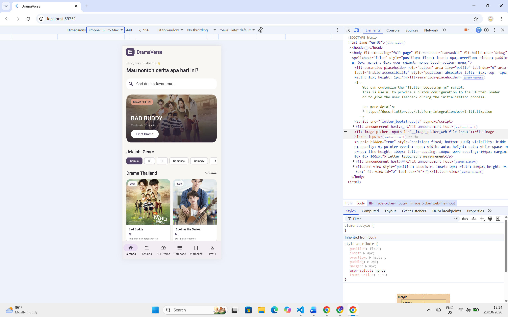

### 8.2 Katalog Drama

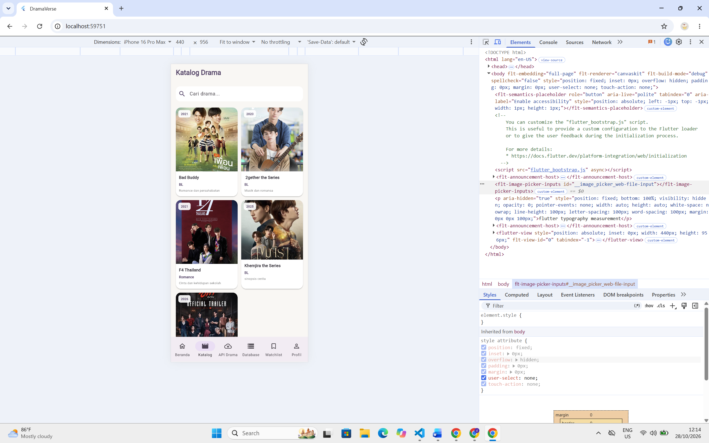

### 8.3 Detail Drama

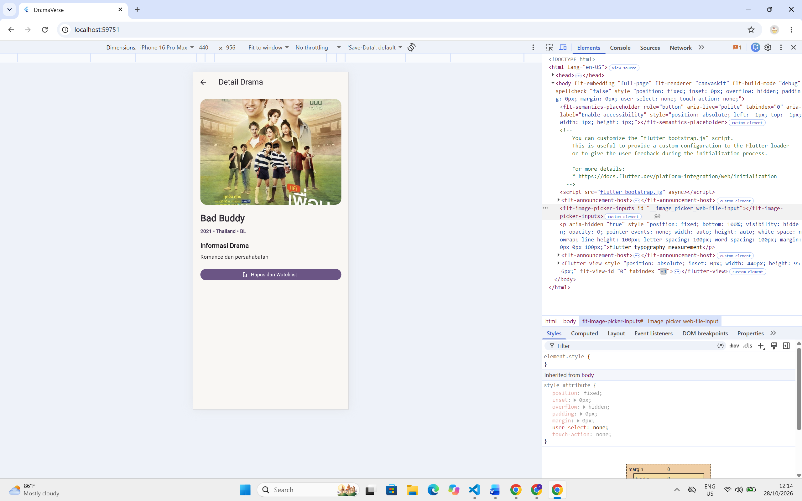

### 8.4 Form Tambah Drama

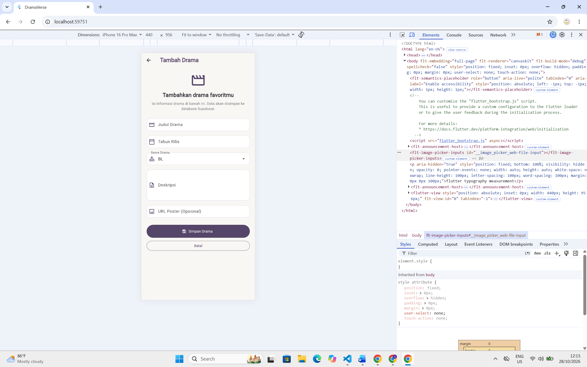

### 8.5 Form Edit Drama

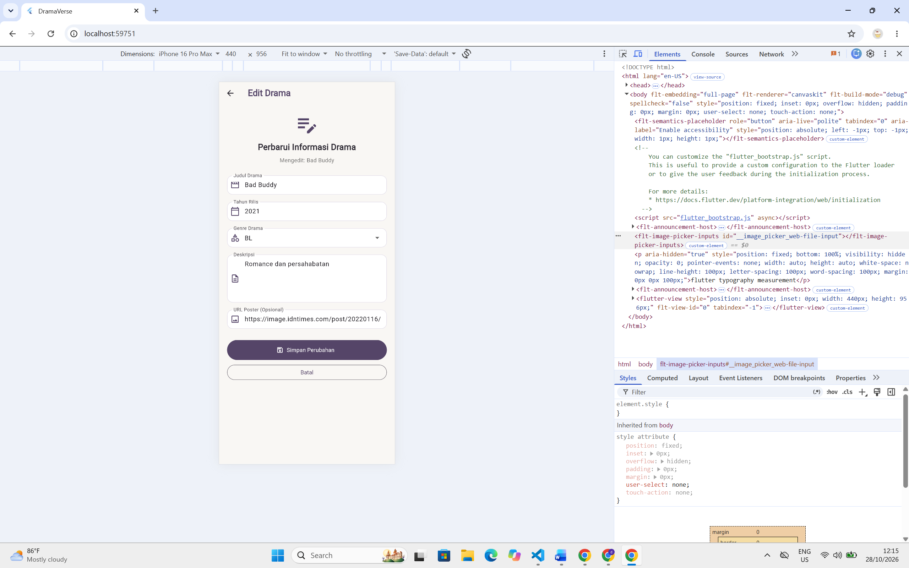

### 8.6 Hapus Drama (Delete)

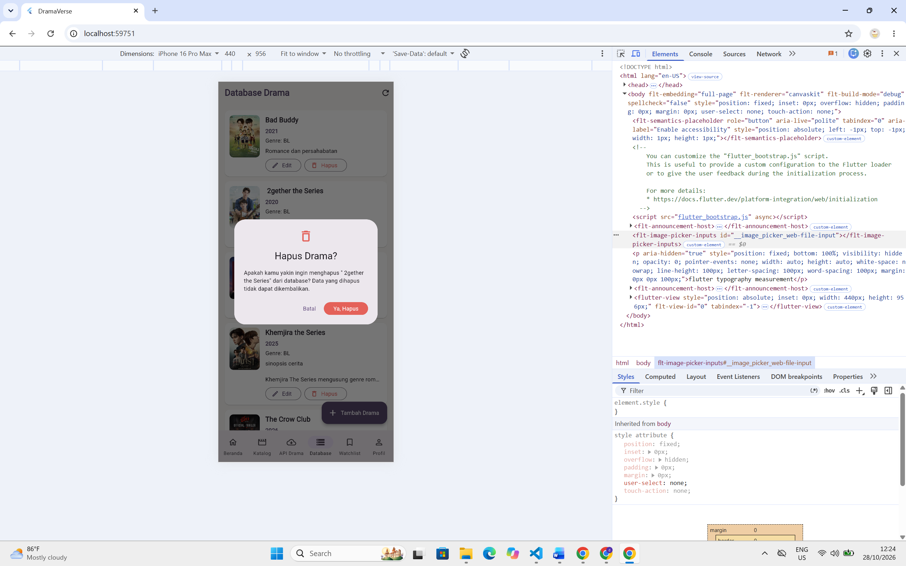

### 8.7 Responsive Layout

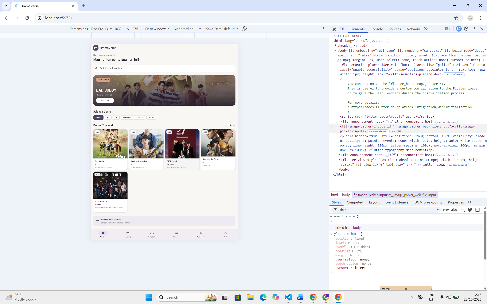

### 8.8 Pencarian REST API

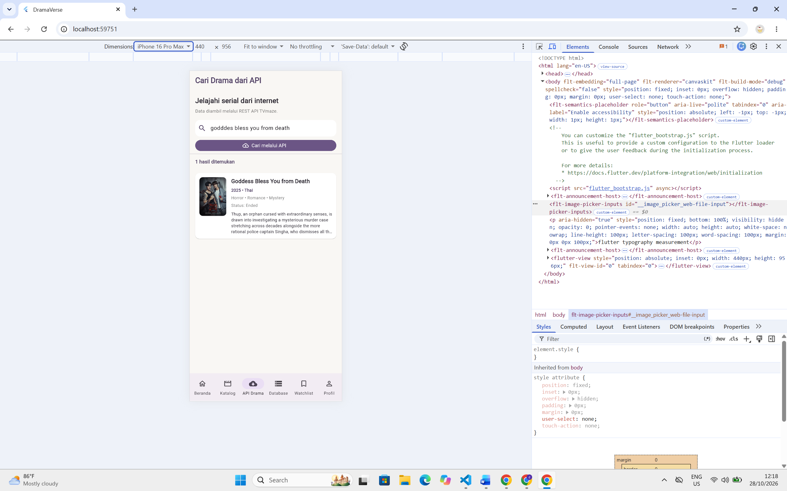

### 8.9 Database Drama

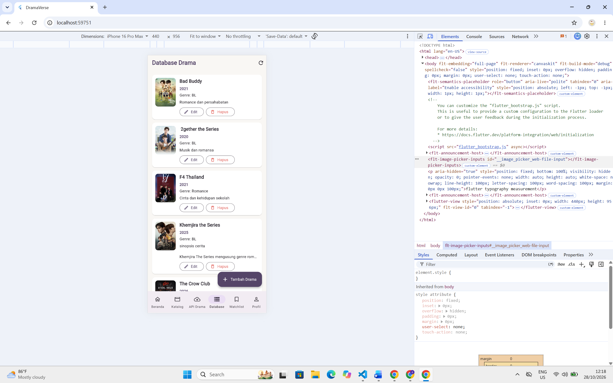

### 8.10 Watchlist

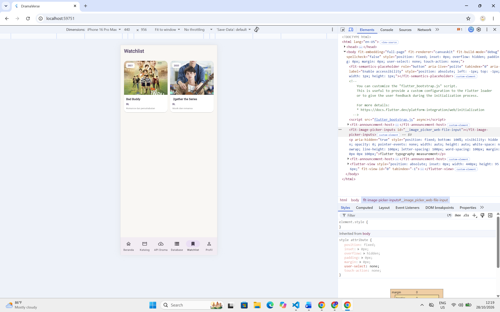

### 8.11 Profil

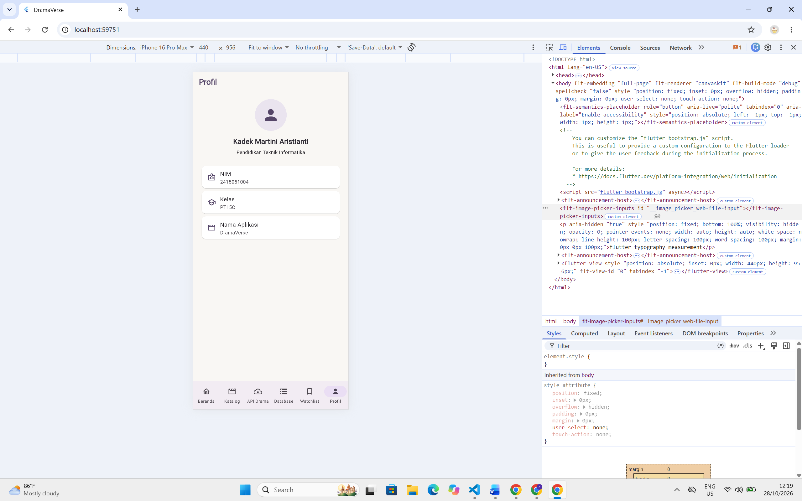


## 9. Cara Menjalankan Project

### Persyaratan

- Flutter SDK.
- Dart SDK yang sesuai dengan versi Flutter.
- Visual Studio Code atau IDE yang mendukung Flutter.
- Emulator atau perangkat yang mendukung Flutter.
- Koneksi internet.
- Proyek Supabase yang telah dikonfigurasi.

### Langkah Menjalankan Aplikasi

**1. Clone repository**

```bash
git clone https://github.com/kadekmartini/UTS_2415051004_KadekMartiniAristianti.git
```

**2. Masuk ke folder proyek**

```bash
cd UTS_2415051004_KadekMartiniAristianti
```

**3. Unduh dependensi**

```bash
flutter pub get
```

**4. Periksa kode**

```bash
flutter analyze
```

**5. Jalankan aplikasi**

```bash
flutter run
```

Pastikan konfigurasi Supabase dan akses database sudah benar agar fitur yang memerlukan koneksi backend dapat digunakan.

## Repository GitHub

Repository proyek DramaVerse dapat diakses melalui:

https://github.com/kadekmartini/UTS_2415051004_KadekMartiniAristianti.git

Untuk melihat riwayat pengembangan melalui Git, gunakan perintah:

```bash
git log --oneline
```

## Download APK

Aplikasi DramaVerse versi Android dapat diunduh melalui Google Drive berikut.

**Link APK:** [Download DramaVerse APK](https://drive.google.com/file/d/1YeV5_CtRsJ3zCt2br0qoMe80813E1gsN/view?usp=drive_link)

Ukuran APK: sekitar 52 MB.

---

**Pengembang:** Kadek Martini Aristianti  
**NIM:** 2415051004  
**Kelas:** PTI 5C  
**Program Studi:** Pendidikan Teknik Informatika  
**Proyek:** DramaVerse — UTS Pemrograman Mobile
